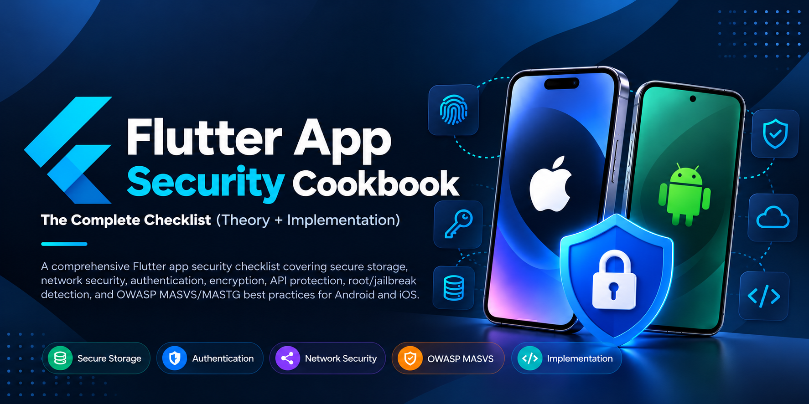

<p align="center">
  <picture>
    <source media="(prefers-color-scheme: dark)" srcset="assets/images/flutter_app_security_cookbook_banner_dark.png">
    <source media="(prefers-color-scheme: light)" srcset="assets/images/flutter_app_security_cookbook_banner_light.png">
    
  </picture>
</p>

# 🛡️ Flutter Security Cookbook

A comprehensive, production-grade security guide, threat-modeling reference, and implementation cookbook for Flutter apps on Android and iOS.

[](https://flutter.dev)
[](https://dart.dev)
[](https://mas.owasp.org/MASVS/)
[-orange?style=flat>)](https://owasp.org/www-project-mobile-top-10/)
[](LICENSE)
[](CONTRIBUTING.md)

This repository bridges high-level application security standards with day-to-day Flutter and Dart engineering. All checklists, patterns, and code recipes are mapped to **OWASP MASVS v2**, **OWASP MASTG**, **OWASP Mobile Top 10 (2024)**, and **OWASP ASVS**.

> ⚠️ **Note:** Platform security APIs, plugin options, and store policies change frequently. Always verify code recipes against the current versions of Flutter, your plugins, and the Android/iOS SDKs before shipping. This cookbook is guidance, not a compliance certification.

---

## 📑 Quick Navigation

- [The Golden Rule](#-the-golden-rule)
- [How to Use This Cookbook](#-how-to-use-this-cookbook)
- [Quick Start: P0 Release Gate](#-quick-start-p0-release-gate)
- [Threat Model & Attacker Tiers](#-threat-model--attacker-tiers)
- [Documentation Blueprint](#%EF%B8%8F-documentation-blueprint--structure)
- [Table of Contents](#-complete-checklist--table-of-contents)
- [Domain-Specific Modules (Section 33)](#-domain-specific-security-modules-section-33)
- [OWASP Mobile Top 10 Mapping](#%EF%B8%8F-owasp-mobile-top-10-2024-mapping)
- [Security Tooling](#%EF%B8%8F-security-tooling-ecosystem)
- [Contributing](#-contributing) · [License](#-license)

---

## ⚡ The Golden Rule

> **A Flutter app is a public, untrusted client.**  
> Anything shipped inside an APK, AAB, or IPA (assets, compile-time constants, Dart AOT snapshots, native libraries) can be extracted, decompiled, and analyzed. Client-side controls (obfuscation, root/jailbreak detection, biometrics, certificate pinning) raise the cost and complexity of an attack, but **server-side authorization, schema validation, and access control are your true security boundaries.**

---

## 📖 How to Use This Cookbook

### 1. Identify Your Application Risk Profile

| Risk Tier  | App Types                                                                                    | Recommended Implementation Scope                                                                                 |
| :--------- | :------------------------------------------------------------------------------------------- | :--------------------------------------------------------------------------------------------------------------- |
| **Low**    | Content readers, public catalog viewers, offline utilities                                   | Enforce all **`[P0]`** controls.                                                                                 |
| **Medium** | Apps with user accounts, personal profile data, social interactions, standard e-commerce     | Enforce all **`[P0]`** + selected **`[P1]`** controls; audit third-party SDKs.                                   |
| **High**   | Fintech, banking, healthcare (PHI), verifiable identity, children/education, enterprise BYOD | Mandatory **`[P0]`** + **`[P1]`** + **`[P2]`** defense-in-depth, plus the matching **Section 33** domain module. |

> **Tip:** The _Risk Tier_ above (how critical your app is) is different from the _Attacker Tier_ below (how capable your adversary is). Use the risk tier to choose the priority scope, and the attacker tiers to choose specific controls.

---

### 2. Priority Matrix

Every control across this cookbook is tagged with an implementation urgency rating:

| Level      | Definition           | Scope                                                                                                                                              |
| :--------- | :------------------- | :------------------------------------------------------------------------------------------------------------------------------------------------- |
| **`[P0]`** | **Must-Have**        | Mandatory baseline before public store release (secure storage, HTTPS-only, server-side authorization, binary hygiene, secret scanning).           |
| **`[P1]`** | **Should-Have**      | Core hardening implemented in initial release cycles (public-key pinning, hardware-backed biometrics, Play Integrity/App Attest, CI/CD SAST/DAST). |
| **`[P2]`** | **Defense-in-Depth** | Advanced controls for high-risk applications (mTLS, DPoP token binding, custom PIN pads, memory wiping, formal red-team testing).                  |

---

### 3. Standards & Baselines Referenced

- **[OWASP MASVS v2](https://mas.owasp.org/MASVS/)**: Mobile Application Security Verification Standard (Categories: `STORAGE`, `CRYPTO`, `AUTH`, `NETWORK`, `PLATFORM`, `CODE`, `RESILIENCE`, `PRIVACY`).
- **[OWASP MASTG](https://mas.owasp.org/MASTG/)**: Mobile Application Security Testing Guide (blackbox, greybox, runtime analysis).
- **[OWASP Mobile Top 10 (2024)](https://owasp.org/www-project-mobile-top-10/)**: The industry-standard vulnerability risk baseline.
- **[OWASP MASWE](https://mas.owasp.org/MASWE/)**: Mobile Application Security Weakness Enumeration.
- **[OWASP ASVS](https://owasp.org/www-project-application-security-verification-standard/)** & **[API Security Top 10](https://owasp.org/www-project-api-security/)**: Backend trust boundary and API service verification.

---

## ✅ Quick Start: P0 Release Gate

Before any public store release, confirm every item below. Each links to the module that explains how.

- [ ] **Threat model done** — assets, trust boundaries, and STRIDE per critical flow ([00](./docs/00-threat-model-and-attacker-tiers.md)).
- [ ] **Authorization is server-side** — every endpoint enforces object-level and role checks ([04](./docs/04-authorization-and-backend-trust-boundary.md)).
- [ ] **No secrets in the binary** — no API keys, private keys, or admin endpoints in code, assets, or `--dart-define` ([07](./docs/07-secure-coding-in-flutter-and-dart.md), [17](./docs/17-add-to-app-build-flavors-and-environment-config.md)).
- [ ] **Tokens in hardware-backed storage** — Keystore / Keychain only; nothing sensitive in `SharedPreferences` or logs ([01](./docs/01-secure-data-storage.md)).
- [ ] **HTTPS only** — cleartext disabled in Android `network_security_config.xml` and iOS ATS ([02](./docs/02-network-security-and-api-communication.md), [15](./docs/15-platform-specific-security-android-and-ios.md)).
- [ ] **Release build hygiene** — `--obfuscate --split-debug-info`, R8 enabled, debug flags and `assert()`-based checks not relied upon ([05](./docs/05-code-and-app-integrity.md), [36](./docs/36-flutter-specific-pitfalls.md)).
- [ ] **Dependencies audited and pinned** — `pubspec.lock` committed, OSV-Scanner clean ([29](./docs/29-supply-chain-and-release-integrity.md)).
- [ ] **Privacy obligations met** — in-app account deletion, accurate store privacy disclosures ([19](./docs/19-privacy-and-data-governance.md)).
- [ ] **Release binary tested** — decompile and proxy tests run against the _release_ artifact ([31](./docs/31-testing-and-continuous-security.md)).

---

## 🎯 Threat Model & Attacker Tiers

Understanding who you are defending against and their capabilities determines which defensive controls to prioritize. Tiers are a spectrum of capability and context, not a strict ladder: a Tier 7 bot farm may never need Tier 5 skills, and a Tier 6 supply-chain compromise can bypass every control below it.

```text
 → T1 Opportunistic               (Lost / stolen phone, shoulder surfing)
 → T2 Malware & Social Eng.       (Accessibility abuse, overlay injection, phishing)
 → T3 Network Attacker            (Rogue Wi-Fi, DNS spoofing, proxy MITM)
 → T4 Root / Jailbreak Attacker   (Frida, objection, memory dumpers, kernel hooks)
 → T5 Reverse Engineer & Cloner   (reFlutter, Ghidra, binary patching, API forgery)
 → T6 Insider & Supply Chain      (Malicious pub packages, poisoned CI/CD, key leaks)
 → T7 Automated Bot & Fraud Scale (Headless emulators, scraping farms, credential stuffing)
```

|    Tier    | Attacker Profile              | Vector & Techniques                                                                                  | Key Mitigations                                                                                                    |
| :--------: | :---------------------------- | :--------------------------------------------------------------------------------------------------- | :----------------------------------------------------------------------------------------------------------------- |
| **Tier 1** | **Opportunistic**             | Lost/stolen unlocked phone, shoulder surfing, curious non-technical users.                           | Device passcode enforcement, auto-lock timeouts, background privacy blur, biometric gates.                         |
| **Tier 2** | **Malware & Social Eng.**     | Accessibility-service abuse, malicious overlays / tapjacking, remote-access tools, phishing/vishing. | Overlay protection (`FLAG_SECURE`, touch filtering), targetSdkVersion hygiene, hardware-bound transaction signing. |
| **Tier 3** | **Network Attacker**          | Rogue Wi-Fi hotspots, compromised gateways, captive portals, TLS proxies.                            | TLS 1.2+ (1.3 preferred), SPKI public-key pinning, cleartext traffic disabled in OS configs.                       |
| **Tier 4** | **Rooted / Jailbroken**       | Device owners using Frida, objection, lldb, memory dumpers, runtime method hooking.                  | RASP / integrity checks, native integrity verification, tamper-evident token binding.                              |
| **Tier 5** | **Reverse Engineer / Cloner** | Decompiles AOT/native binaries, patches checks, repackages APKs/IPAs, direct API scraping.           | Dart AOT `--obfuscate`, R8, Play Integrity / App Attest, strong server-side API auth.                              |
| **Tier 6** | **Insider / Supply Chain**    | Compromised `pub.dev` package, malicious build action in CI/CD, leaked signing keystore.             | Dependency lock pinning, provenance checks, OSV-Scanner, ephemeral CI signing keys.                                |
| **Tier 7** | **Automation & Abuse**        | Headless botnets, credential stuffing, fake account generators, promo and referral farmers.          | Device attestation, proof-of-work / CAPTCHA gates, API rate-limiting, IP reputation.                               |

Full detail, STRIDE modeling, and test recipes live in [**00. Threat Model & Attacker Tiers**](./docs/00-threat-model-and-attacker-tiers.md).

---

## 🗂️ Documentation Blueprint & Structure

Each guide inside [`docs/`](./docs) follows a structured, implementation-first blueprint:

1. **Threat Model & Realistic Scenarios**: attacker profile, STRIDE categorization, MASVS requirement mapping.
2. **Theory & Mechanics**: underlying OS mechanisms (Keystore, Keychain, Secure Enclave, Binder) and Flutter engine internals.
3. **Flutter Implementation**: complete, idiomatic Dart/Flutter code recipes with Android (Kotlin) and iOS (Swift) platform channels where required.
4. **Testing & Verification**: concrete reproduction steps, CLI commands, and pentesting tool recipes (Frida, MobSF, Burp).
5. **Common Pitfalls & Anti-Patterns**: vulnerable vs. hardened side-by-side comparisons.
6. **Standards Mapping**: MASVS v2 and OWASP Mobile Top 10 cross-reference for each control.

```text
flutter-app-security-cookbook/
├── docs/
│   ├── 00-threat-model-and-attacker-tiers.md
│   ├── 01-secure-data-storage.md
│   ├── 02-network-security-and-api-communication.md
│   ├── ...
│   ├── 32-compliance-and-regulatory-considerations.md
│   ├── 33-domain-specific-modules/
│   │   ├── 33.1-fintech-banking-payments.md
│   │   ├── 33.2-healthcare-and-wellness.md
│   │   ├── 33.3-ecommerce-and-marketplaces.md
│   │   └── ...
│   ├── 34-qr-codes-urls-and-external-content.md
│   ├── 35-additional-android-and-ios-hardening.md
│   ├── 36-flutter-specific-pitfalls.md
│   └── 37-owasp-mobile-top-10-and-emerging-risks.md
├── assets/images/
├── CONTRIBUTING.md
├── LICENSE
└── README.md
```

---

## 📚 Complete Checklist & Table of Contents

### 🧱 Core Foundations & Client Hardening

- [**00. Threat Model & Attacker Tiers**](./docs/00-threat-model-and-attacker-tiers.md) `[P0/P1]`  
  STRIDE modeling, trust boundaries, asset classification, and Attacker Tiers 1–7.
- [**01. Secure Data Storage**](./docs/01-secure-data-storage.md) `[P0/P1/P2]`  
  `flutter_secure_storage`, Android Keystore & encrypted storage, iOS Keychain & Secure Enclave, database encryption (SQLCipher), backup exclusions, and memory hygiene.
- [**02. Network Security & API Communication**](./docs/02-network-security-and-api-communication.md) `[P0/P1/P2]`  
  TLS enforcement (1.3 preferred), SPKI public-key pinning, OAuth token refresh rotation, HMAC request signing, replay defense, and Dart `SecurityContext` / proxy nuances.
- [**03. Authentication & Session Management**](./docs/03-authentication-and-session-management.md) `[P0/P1/P2]`  
  OAuth 2.0 + PKCE (per OAuth 2.1 best practices and RFC 8252) via ASWebAuthenticationSession / Custom Tabs, Passkeys / FIDO2, MFA step-up, secure OTP handling, and synchronized session revocation.
- [**04. Authorization & Backend Trust Boundary**](./docs/04-authorization-and-backend-trust-boundary.md) `[P0/P1]`  
  BOLA/IDOR mitigations, zero-trust backend contracts, gateway rate-limiting, and eliminating client-enforced authorization bypasses.
- [**05. Code & App Integrity**](./docs/05-code-and-app-integrity.md) `[P0/P1/P2]`  
  Dart AOT `--obfuscate --split-debug-info`, R8/ProGuard configuration, Play Integrity API & iOS App Attest, RASP (freeRASP), and anti-tamper repackaging defenses.
- [**06. Input Validation & Injection Prevention**](./docs/06-input-validation-and-injection-prevention.md) `[P0/P1]`  
  Client & server schema validation, parameterized queries, path traversal defense, file format sanitization, and business logic safeguards.
- [**07. Secure Coding in Flutter & Dart**](./docs/07-secure-coding-in-flutter-and-dart.md) `[P0/P1/P2]`  
  Eliminating hardcoded secrets, Dart memory lifecycle, immutable data structures, dependency vulnerability audits, and platform channel boundary validation.
- [**08. Cryptography & Key Management**](./docs/08-cryptography-and-key-management.md) `[P0/P1/P2]`  
  AES-256-GCM, ChaCha20-Poly1305, cryptographically secure nonces/IVs (CSPRNG), PBKDF2/Argon2 KDFs, Secure Enclave keys, and post-quantum roadmaps.
- [**09. Biometrics, PIN & Device Binding**](./docs/09-biometrics-pin-and-device-binding.md) `[P0/P1/P2]`  
  Moving beyond boolean `local_auth` gates: hardware-backed key signing (`CryptoObject` / `SecKey`), progressive rate-limited PIN lockouts, and cryptographic device pairing.

---

### 📱 Platform Boundaries & OS Surfaces

- [**10. Deep Links, WebViews & Inter-App Communication**](./docs/10-deep-links-webviews-and-inter-app-communication.md) `[P0/P1/P2]`  
  Android App Links, iOS Universal Links, WebView JavaScript bridge hardening, file scheme blocking, and intent redirection defense.
- [**11. Clipboard, Screenshots & Background Privacy**](./docs/11-clipboard-screenshots-autofill-background-privacy.md) `[P1/P2]`  
  Task switcher privacy masking (`FLAG_SECURE`, native blur overlays), programmatic clipboard clearing, sensitive input autofill hints, and third-party keyboard (IME) privacy.
- [**12. Push & Local Notifications**](./docs/12-push-and-local-notifications.md) `[P0/P1/P2]`  
  Lockscreen preview masking, eliminating tokens/OTPs from notification payloads, authenticated deep-link payloads, and Notification Service Extensions.
- [**13. Permissions, Sensors & Hardware Access**](./docs/13-permissions-sensors-and-hardware-access.md) `[P0/P1/P2]`  
  Least-privilege scoping, Photo Picker (avoiding broad `READ_MEDIA_IMAGES`), approximate vs. precise location, BLE link-layer encryption, and OS manifest audits.
- [**14. File Handling, Media, Downloads & Sharing**](./docs/14-file-handling-media-downloads-and-sharing.md) `[P0/P1/P2]`  
  Android Scoped Storage, iOS sandbox isolation, EXIF metadata stripping, Zip-Slip defense, and secure `FileProvider` configuration.
- [**15. Platform-Specific Security (Android & iOS)**](./docs/15-platform-specific-security-android-and-ios.md) `[P0/P1]`  
  Android `network_security_config.xml`, iOS App Transport Security (ATS), Apple Privacy Manifests (`PrivacyInfo.xcprivacy`), and Secure Enclave access control flags.
- [**16. Extensions, Widgets & Additional App Surfaces**](./docs/16-extensions-widgets-and-additional-app-surfaces.md) `[P0/P1]`  
  Securing App Groups, Live Activities, Android RemoteViews/AppWidgets, `PendingIntent` immutability (`FLAG_IMMUTABLE`), and watch/car companion interfaces.
- [**17. Add-to-App, Build Flavors & Environment Configuration**](./docs/17-add-to-app-build-flavors-and-environment-config.md) `[P0/P1/P2]`  
  Hardening Flutter modules embedded in native hosts, multi-flavor build configurations, avoiding secrets in `--dart-define`, and CI artifact verification.

---

### 🌐 Architecture, Ecosystem & Emerging Threats

- [**18. Third-Party SDKs, BaaS, Ads & Analytics**](./docs/18-third-party-sdks-baas-ads-and-analytics.md) `[P0/P1/P2]`  
  Firebase/Supabase security rule audits, Firebase App Check, restricted API keys, and third-party tracker sandboxing.
- [**19. Privacy & Data Governance**](./docs/19-privacy-and-data-governance.md) `[P0/P1]`  
  Mandatory in-app account & data deletion flows, GDPR/CCPA data export, App Store privacy labels, and Google Play Data Safety forms.
- [**20. Logging, Monitoring & Error Handling**](./docs/20-logging-monitoring-and-error-handling.md) `[P0/P1/P2]`  
  Crashlytics/Sentry sensitive-data scrubbing, remote security kill-switches, SIEM event alerting, and generic user-facing error abstractions.
- [**21. Abuse, Fraud & Anti-Bot Controls**](./docs/21-abuse-fraud-and-anti-bot-controls.md) `[P0/P1/P2]`  
  Credential stuffing countermeasures, device fingerprinting caveats, dynamic rate-limiting, and clone app detection.
- [**22. In-App Purchases, Subscriptions & Licensing**](./docs/22-in-app-purchases-subscriptions-and-licensing.md) `[P0/P1/P2]`  
  Server-side receipt verification (App Store Server API & Google Play Developer API with RTDN), entitlement tampering defense, and promo code abuse prevention.
- [**23. Real-Time, Chat & User-Generated Content**](./docs/23-real-time-chat-and-user-generated-content.md) `[P0/P1/P2]`  
  WebSocket room authorization, End-to-End Encryption (E2EE) protocols, rich-text XSS prevention, and automated media content moderation.
- [**24. AI & LLM Features in Apps**](./docs/24-ai-and-llm-features-in-apps.md) `[P0/P1/P2]`  
  Server-mediated LLM interactions (never expose model-provider API keys in the client), prompt-injection mitigation, API cost throttling, and on-device model IP protection.
- [**25. OTA Updates & Code Push**](./docs/25-ota-updates-and-code-push.md) `[P0/P1]`  
  Shorebird/code-push patch signing verification, KMS-held release keys, rollback policies, and platform store guideline compliance.
- [**26. Offline Mode & Data Synchronization**](./docs/26-offline-mode-and-data-synchronization.md) `[P0/P1]`  
  Replay attack prevention for offline action queues, encrypted local state storage, and conflict-resolution privilege checks.
- [**27. Device Signal Tampering: Clock, Location & Environment**](./docs/27-device-signal-tampering-clock-location-environment.md) `[P1/P2]`  
  Server-authoritative time (NTP/TrueTime), mock GPS detection, emulator/virtualization indicators, and anti-tamper telemetry.
- [**28. Fail-Open vs. Fail-Closed Policy & Resilience**](./docs/28-fail-open-vs-fail-closed-resilience.md) `[P0/P1]`  
  Explicit security degradation policies, attestation failure handling during connectivity outages, and false-positive recovery mechanisms.

---

### 🚀 DevSecOps, Operations & Platform Hardening

- [**29. Supply Chain & Release Integrity**](./docs/29-supply-chain-and-release-integrity.md) `[P0/P1/P2]`  
  `pubspec.lock` version pinning, Software Bill of Materials (SBOM) generation, GitHub Actions CI hardening, Google Play App Signing, and dependency provenance.
- [**30. Incident Response & Security Operations**](./docs/30-incident-response-and-security-operations.md) `[P0/P1/P2]`  
  Runbooks for compromised signing keys / leaked API tokens, `.well-known/security.txt`, fast-path security patch deployments, and breach tabletop exercises.
- [**31. Testing & Continuous Security**](./docs/31-testing-and-continuous-security.md) `[P0/P1]`  
  Release-build penetration testing, automated CI SAST (Semgrep, OSV-Scanner), dynamic instrumentation (Frida, objection, reFlutter), and MobSF pipelines.
- [**32. Compliance & Regulatory Considerations**](./docs/32-compliance-and-regulatory-considerations.md) `[P0/P1]`  
  Mapping mobile controls to GDPR, HIPAA, PCI DSS v4, India DPDP, COPPA, and Apple/Google review mandates.
- [**33. Domain-Specific Modules**](#-domain-specific-security-modules-section-33) `[P0/P1/P2]`  
  Vertical modules for fintech, healthcare, e-commerce, social, kids/EdTech, enterprise, IoT, gaming, mobility, and government (see table below).
- [**34. QR Codes, URLs & External Content**](./docs/34-qr-codes-urls-and-external-content.md) `[P0/P1/P2]`  
  Quishing (QR phishing) defenses, URL scheme sanitization, domain normalization, short-lived signed action tokens, and preview confirmations.
- [**35. Additional Android & iOS Hardening**](./docs/35-additional-android-and-ios-hardening.md) `[P0/P1]`  
  `RECEIVER_NOT_EXPORTED` flags, App Attest assertion validation, Keychain access groups, and Apple Lockdown Mode testing.
- [**36. Flutter-Specific Pitfalls**](./docs/36-flutter-specific-pitfalls.md) `[P0/P1/P2]`  
  Common traps: bundled asset exposure, `assert()` being stripped in release mode, Flutter version pinning (`fvm`), and Dart proxy-handling behavior.
- [**37. OWASP Mobile Top 10 & Emerging Risks**](./docs/37-owasp-mobile-top-10-and-emerging-risks.md) `[P1/P2]`  
  Deep-dive mappings for M1–M10 plus emerging candidate risks beyond the official list.

---

### 🏢 Domain-Specific Security Modules (Section 33)

Tailor your baseline with dedicated vertical modules:

|                                             Module                                              | Title                                      | Primary Focus & Regulatory Frameworks                                                                                                                      |
| :---------------------------------------------------------------------------------------------: | :----------------------------------------- | :--------------------------------------------------------------------------------------------------------------------------------------------------------- |
|         **[33.1](./docs/33-domain-specific-modules/33.1-fintech-banking-payments.md)**          | **Fintech, Banking & Payments**            | PCI DSS v4, Strong Customer Authentication (SCA), device-bound transaction signing, screen overlay defenses, and regional mandates (e.g. RBI, NPCI, PSD2). |
|          **[33.2](./docs/33-domain-specific-modules/33.2-healthcare-and-wellness.md)**          | **Healthcare & Wellness**                  | HIPAA & GDPR PHI controls, encrypted telehealth WebRTC sessions, HealthKit / Health Connect audit trails, and break-glass clinical access flows.           |
|        **[33.3](./docs/33-domain-specific-modules/33.3-ecommerce-and-marketplaces.md)**         | **E-Commerce & Marketplaces**              | Client price/discount tampering prevention, inventory-bot scalper mitigation, IDOR protection on orders, and carding attack mitigations.                   |
|      **[33.4](./docs/33-domain-specific-modules/33.4-social-messaging-and-community.md)**       | **Social, Messaging & Community**          | Audited E2EE (Signal/MLS) protocol integration, in-app harassment reporting, safe media rendering, and private-by-default user settings.                   |
|         **[33.5](./docs/33-domain-specific-modules/33.5-kids-education-and-edtech.md)**         | **Kids, Education & EdTech**               | COPPA & GDPR-K compliance, verifiable adult parental gates, zero third-party behavioral analytics, and exam proctoring lockdown.                           |
|     **[33.6](./docs/33-domain-specific-modules/33.6-enterprise-productivity-and-byod.md)**      | **Enterprise, Productivity & BYOD**        | SAML/OIDC enterprise SSO, MDM/MAM support (Microsoft Intune, VMware Workspace ONE), selective enterprise remote wipe, and tenant isolation.                |
|       **[33.7](./docs/33-domain-specific-modules/33.7-iot-smart-home-and-automotive.md)**       | **IoT, Smart Home & Automotive**           | BLE/MQTT pairing key exchange, authenticated local firmware distribution, fail-safe offline hardware states, and telemetry data minimization.              |
|         **[33.8](./docs/33-domain-specific-modules/33.8-gaming-and-entertainment.md)**          | **Gaming & Entertainment**                 | Server-authoritative game loops, anti-speedhack / memory-scanner heuristics, FairPlay/Widevine DRM media protection, and minor spending limits.            |
|     **[33.9](./docs/33-domain-specific-modules/33.9-ride-hailing-delivery-and-travel.md)**      | **Ride-Hailing, Delivery & Travel**        | Masked VoIP/SMS relay channels, GPS mock-location and spoofing detection, dispatch fraud prevention, and emergency SOS dispatch integration.               |
| **[33.10](./docs/33-domain-specific-modules/33.10-government-identity-and-public-services.md)** | **Government, Identity & Public Services** | Hardware-backed verifiable credentials (mDL, ISO 18013-5), phishing-resistant citizen authentication, and identity document data redaction.                |

---

## 🗺️ OWASP Mobile Top 10 (2024) Mapping

Direct cross-reference mapping your controls to the latest OWASP Mobile Top 10 standard:

| OWASP ID | Category Name                             | Corresponding Cookbook Modules                                                                                                                                                                                                                                                                                                       |
| :------: | :---------------------------------------- | :----------------------------------------------------------------------------------------------------------------------------------------------------------------------------------------------------------------------------------------------------------------------------------------------------------------------------------- |
|  **M1**  | **Improper Credential Usage**             | [01](./docs/01-secure-data-storage.md), [03](./docs/03-authentication-and-session-management.md), [07](./docs/07-secure-coding-in-flutter-and-dart.md), [17](./docs/17-add-to-app-build-flavors-and-environment-config.md), [18](./docs/18-third-party-sdks-baas-ads-and-analytics.md), [36](./docs/36-flutter-specific-pitfalls.md) |
|  **M2**  | **Inadequate Supply Chain Security**      | [18](./docs/18-third-party-sdks-baas-ads-and-analytics.md), [25](./docs/25-ota-updates-and-code-push.md), [29](./docs/29-supply-chain-and-release-integrity.md), [36](./docs/36-flutter-specific-pitfalls.md)                                                                                                                        |
|  **M3**  | **Insecure Authentication/Authorization** | [03](./docs/03-authentication-and-session-management.md), [04](./docs/04-authorization-and-backend-trust-boundary.md), [09](./docs/09-biometrics-pin-and-device-binding.md), [21](./docs/21-abuse-fraud-and-anti-bot-controls.md)                                                                                                    |
|  **M4**  | **Insufficient Input/Output Validation**  | [06](./docs/06-input-validation-and-injection-prevention.md), [10](./docs/10-deep-links-webviews-and-inter-app-communication.md), [14](./docs/14-file-handling-media-downloads-and-sharing.md), [34](./docs/34-qr-codes-urls-and-external-content.md)                                                                                |
|  **M5**  | **Insecure Communication**                | [02](./docs/02-network-security-and-api-communication.md), [18](./docs/18-third-party-sdks-baas-ads-and-analytics.md)                                                                                                                                                                                                                |
|  **M6**  | **Inadequate Privacy Controls**           | [13](./docs/13-permissions-sensors-and-hardware-access.md), [16](./docs/16-extensions-widgets-and-additional-app-surfaces.md), [18](./docs/18-third-party-sdks-baas-ads-and-analytics.md), [19](./docs/19-privacy-and-data-governance.md), [32](./docs/32-compliance-and-regulatory-considerations.md)                               |
|  **M7**  | **Insufficient Binary Protections**       | [05](./docs/05-code-and-app-integrity.md), [27](./docs/27-device-signal-tampering-clock-location-environment.md), [28](./docs/28-fail-open-vs-fail-closed-resilience.md)                                                                                                                                                             |
|  **M8**  | **Security Misconfiguration**             | [15](./docs/15-platform-specific-security-android-and-ios.md), [17](./docs/17-add-to-app-build-flavors-and-environment-config.md), [35](./docs/35-additional-android-and-ios-hardening.md), [36](./docs/36-flutter-specific-pitfalls.md)                                                                                             |
|  **M9**  | **Insecure Data Storage**                 | [01](./docs/01-secure-data-storage.md), [11](./docs/11-clipboard-screenshots-autofill-background-privacy.md), [14](./docs/14-file-handling-media-downloads-and-sharing.md), [26](./docs/26-offline-mode-and-data-synchronization.md), [35](./docs/35-additional-android-and-ios-hardening.md)                                        |
| **M10**  | **Insufficient Cryptography**             | [08](./docs/08-cryptography-and-key-management.md), [09](./docs/09-biometrics-pin-and-device-binding.md)                                                                                                                                                                                                                             |

> 📌 _For emerging candidate risks (e.g., sensitive data leakage via system logs, hardcoded backend endpoints, and unauthenticated RPCs), see [**Section 37: Emerging Risks**](./docs/37-owasp-mobile-top-10-and-emerging-risks.md)._

---

## 🛠️ Security Tooling Ecosystem

This cookbook incorporates industry-standard tooling for testing **release** binaries:

| Category                                  | Primary Tools                                                                                                                                                                 | Application                                                                                                        |
| :---------------------------------------- | :---------------------------------------------------------------------------------------------------------------------------------------------------------------------------- | :----------------------------------------------------------------------------------------------------------------- |
| **Static & Dynamic Analysis (SAST/DAST)** | [MobSF](https://github.com/MobSF/Mobile-Security-Framework-MobSF), [jadx](https://github.com/skylot/jadx), [apktool](https://apktool.org/), [Ghidra](https://ghidra-sre.org/) | Decompiling native Android/iOS layers, analyzing manifests, inspecting compiled symbols.                           |
| **Network & Traffic Inspection**          | [Burp Suite](https://portswigger.net/burp), [mitmproxy](https://mitmproxy.org/), [Charles Proxy](https://www.charlesproxy.com/)                                               | Intercepting HTTP/S traffic, validating cert-pinning failure behavior, testing API tampering.                      |
| **Runtime Instrumentation & Hooking**     | [Frida](https://frida.re/), [objection](https://github.com/sensepost/objection), [reFlutter](https://github.com/Impact-I/reFlutter)                                           | Bypassing SSL pinning, hooking native/Dart runtime behavior, inspecting in-memory values, testing RASP resilience. |
| **Supply Chain & Vulnerability Scanning** | [OSV-Scanner](https://github.com/google/osv-scanner), [Dependabot](https://github.com/dependabot), [Trivy](https://github.com/aquasecurity/trivy)                             | Auditing `pubspec.lock` against known CVE databases and identifying insecure dependencies in CI.                   |

> ⚖️ Only test applications and infrastructure you own or are explicitly authorized to assess.

---

## 🤝 Contributing

Contributions, bug reports, and updates regarding new Android/iOS platform security rules or Flutter engine changes are welcome!

1. Check open issues or start a discussion.
2. Read [`CONTRIBUTING.md`](CONTRIBUTING.md) for style and PR guidelines.
3. Submit a pull request with clear rationale, OWASP MASVS mappings, and reproducible code samples.

---

## 📄 License

This project is licensed under the [MIT License](LICENSE). The license covers the documentation, diagrams, and code samples in this repository.

> ⚖️ **Disclaimer:** This cookbook is educational guidance, not legal, compliance, or security certification advice. Security requirements vary by app and jurisdiction. Review all code samples before using them in production, and test only systems you own or are authorized to assess.
