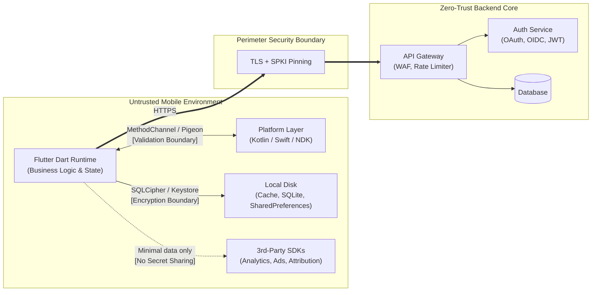

# 00. Threat Model & Attacker Tiers

> **Priority:** `[P0]` (STRIDE per feature, asset inventory, trust boundary definition) / `[P1]` (attacker tier mapping, MASVS/OWASP coverage, data classification, and explicit out-of-scope definitions)  
> **Target Platforms:** Android & iOS  
> **Relevant Standards:** OWASP MASVS v2 (`MASVS-STORAGE`, `MASVS-CRYPTO`, `MASVS-AUTH`, `MASVS-NETWORK`, `MASVS-PLATFORM`, `MASVS-CODE`, `MASVS-RESILIENCE`, `MASVS-PRIVACY`), OWASP Mobile Top 10 (2024), OWASP ASVS v4

---

## 1. Threat: Who You Are Defending Against

Mobile security is not binary: it is governed by the capability, tooling, economic motivation, and physical access of the adversary. A common architectural failure in Flutter engineering is applying uniform defenses without understanding which attacker tier can defeat them.

Tiers describe _capability and context_, not a strict ladder. A Tier 7 bot farm may never need Tier 5 skills, and a Tier 6 supply-chain compromise can bypass every control aimed at Tiers 1–5.

```text
 → T1 Opportunistic               (Lost / stolen phone, shoulder surfing)
 → T2 Malware & Social Eng.       (Accessibility abuse, overlay injection, phishing)
 → T3 Network Attacker            (Rogue Wi-Fi, DNS spoofing, proxy MITM)
 → T4 Root / Jailbreak Attacker   (Frida, objection, memory dumpers, kernel hooks)
 → T5 Reverse Engineer & Cloner   (reFlutter, Ghidra, binary patching, API forgery)
 → T6 Insider & Supply Chain      (Malicious pub packages, poisoned CI/CD, key leaks)
 → T7 Automated Bot & Fraud Scale (Headless emulators, scraping farms, credential stuffing)
```

### Attacker Profiles & Capabilities

|    Tier    | Profile                        | Vector & Tooling                                                                                                                                     | Objective                                                                                                       | Example Scenario                                                                                                                                             |
| :--------: | :----------------------------- | :--------------------------------------------------------------------------------------------------------------------------------------------------- | :-------------------------------------------------------------------------------------------------------------- | :----------------------------------------------------------------------------------------------------------------------------------------------------------- |
| **Tier 1** | **Opportunistic**              | Lost or stolen unlocked handset, shoulder surfing, inquisitive acquaintance.                                                                         | Access cached personal data, read SMS/notifications, abuse active sessions.                                     | A user leaves their phone on a café table; an attacker opens the unlocked app to view account balances or transfer funds.                                    |
| **Tier 2** | **Malware & Social Eng.**      | Malicious accessibility services (Android), screen overlays, tapjacking, abuse of legitimate remote-support apps (AnyDesk/TeamViewer), SMS phishing. | Harvest credentials, intercept 2FA codes, trick users into approving unauthorized transactions.                 | An accessibility trojan detects the Flutter window, reads on-screen content via the accessibility node tree, or injects an overlay over the PIN pad.         |
| **Tier 3** | **Network Attacker**           | Rogue public Wi-Fi hotspots, ARP poisoning, compromised DNS resolvers, TLS interception proxies (`mitmproxy`, `Burp Suite`).                         | Intercept session tokens, inspect API payloads, replay transactions, manipulate backend responses.              | Attacker sets up a fake "Free Airport Wi-Fi" and presents forged certificates to capture requests from clients that do not pin or that trust user-added CAs. |
| **Tier 4** | **Rooted / Jailbroken Device** | Rooted Android (Magisk, KernelSU, APatch) or jailbroken iOS running Frida, objection, lldb, Cycript.                                                 | Bypass local biometrics, dump heap memory, hook native/engine symbols, defeat client-side validation.           | Attacker uses Frida to force a local check (`checkBiometrics() => true`) to succeed, or intercepts decrypted payload parameters in RAM.                      |
| **Tier 5** | **Reverse Engineer / Cloner**  | Binary decompilation (`jadx`, `Ghidra`, `apktool`), Dart snapshot analysis/patching (`reFlutter`, `darter`), binary repacking.                       | Extract proprietary algorithms, find hidden API endpoints, remove license checks, publish malicious clone apps. | Attacker extracts `libapp.so`, uses `reFlutter` to bypass TLS verification, and re-signs the APK to inspect private backend protocols.                       |
| **Tier 6** | **Insider & Supply Chain**     | Compromised `pub.dev` dependency, malicious GitHub Action in CI/CD, stolen release signing keystore, untrusted third-party SDK.                      | Inject backdoors into the compiled artifact, exfiltrate user data at runtime, compromise release signing.       | A popular open-source package ships an update that reads the clipboard or stored tokens and silently transmits them to an external server.                   |
| **Tier 7** | **Automation & Abuse**         | Emulated device farms, scriptable headless clients, credential stuffing scripts, bot frameworks.                                                     | Mass account creation, voucher/promo depletion, inventory scalping, bulk API scraping.                          | A fraudster scripts calls against mobile API endpoints using harvested client tokens to drain loyalty points across thousands of accounts.                   |

### Tier-to-Control Prioritization Matrix

Use this to decide where to invest first. ● = primary defense, ○ = supporting defense.

| Control Area                                  | T1  | T2  | T3  | T4  | T5  | T6  | T7  |
| :-------------------------------------------- | :-: | :-: | :-: | :-: | :-: | :-: | :-: |
| Server-side authorization (RBAC / BOLA)       |  ○  |  ○  |  ○  |  ●  |  ●  |  ○  |  ●  |
| Hardware-backed secret storage                |  ●  |  ○  |  ○  |  ○  |     |     |     |
| Biometric / PIN gate with key binding         |  ●  |  ○  |     |  ○  |     |     |     |
| Overlay / screenshot / background privacy     |  ●  |  ●  |     |     |     |     |     |
| TLS + SPKI pinning                            |     |     |  ●  |  ○  |  ○  |     |     |
| App attestation (Play Integrity / App Attest) |     |     |     |  ●  |  ●  |     |  ●  |
| Obfuscation + R8 + RASP                       |     |  ○  |     |  ○  |  ●  |     |     |
| Dependency pinning, SBOM, CI hardening        |     |     |     |     |     |  ●  |     |
| Rate limiting, bot / fraud detection          |     |     |     |     |     |     |  ●  |

---

## 2. Why It Matters (Theory & Standards)

### The Golden Rule of Mobile Architecture

> **A Flutter application is a public, untrusted client executing in an adversarial environment.**  
> Everything packaged inside an APK, AAB, or IPA (assets, bundled CA certificates, `--dart-define` constants, compiled AOT snapshots, native shared libraries) can be extracted, analyzed, and modified by an attacker with physical or root access.  
> Client-side hardening controls (obfuscation, root detection, biometrics, certificate pinning) exist only to **raise the attacker's work factor** (cost, time, tooling sophistication). **The primary security and authorization boundary MUST live on the backend server.**

### Threat Modeling Workflow

Run this lightweight process for every new feature and again before each major release:

1. **Inventory assets.** What data, capabilities, and money does the feature touch?
2. **Draw the data flow.** Mark every trust boundary the data crosses.
3. **Apply STRIDE** to each flow and boundary (table below).
4. **Pick attacker tiers.** Decide which tiers are realistic for your app's risk profile.
5. **Assign controls and priorities** (`P0`/`P1`/`P2`), and document the owner.
6. **Record residual risk** you are knowingly accepting, with an expiry date for review.
7. **Verify** with the test recipes in Section 4.

#### Asset Inventory Template

| Asset         | Data Class (A–D) | Where It Lives (device / network / backend) | Impact if Compromised | Relevant Attacker Tiers | Controls                       | Owner |
| :------------ | :--------------: | :------------------------------------------ | :-------------------- | :---------------------- | :----------------------------- | :---- |
| Refresh token |        D         | Keystore / Keychain, API gateway            | Account takeover      | 2, 3, 4, 6              | Secure storage, rotation, DPoP |       |
| Order history |        C         | Encrypted DB, backend                       | Privacy exposure      | 1, 4                    | SQLCipher, server-side authz   |       |
| _(add rows)_  |                  |                                             |                       |                         |                                |       |

#### Residual Risk Register Template

| ID  | Risk Accepted                                  | Rationale                  | Compensating Control          | Owner | Review Date |
| :-- | :--------------------------------------------- | :------------------------- | :---------------------------- | :---- | :---------- |
| R1  | Rooted-device users can read local cached data | Low-sensitivity cache only | Server-side authz, short TTLs |       |             |

### STRIDE Modeling per Mobile Feature

Apply the STRIDE threat model to every critical mobile flow (authentication, checkout, profile modification, payment, WebViews):

| STRIDE Threat              | Mobile Attack Vector                                                                                | Primary Flutter / Client Defense                                                                  | Primary Backend Security Boundary                                                                                  |
| :------------------------- | :-------------------------------------------------------------------------------------------------- | :------------------------------------------------------------------------------------------------ | :----------------------------------------------------------------------------------------------------------------- |
| **Spoofing**               | Forged user identity, hijacked access tokens, fake client device headers.                           | Hardware-backed keystore tokens (`flutter_secure_storage`), cryptographic device binding.         | OAuth 2.0 + PKCE authorization-code validation, DPoP (Demonstrating Proof-of-Possession), mTLS.                    |
| **Tampering**              | Patched Dart AOT snapshots, modified SQLite databases, altered deep-link parameters.                | AOT obfuscation (`--obfuscate`), R8/ProGuard, database encryption (SQLCipher).                    | Cryptographic payload signing (HMAC-SHA256), server-side input schema validation, immutable audit logs.            |
| **Repudiation**            | User claims: _"I never initiated that $1,000 transfer."_                                            | Hardware-backed biometric transaction signing (`SecKey` / `CryptoObject`).                        | Server-authoritative transaction receipts, asymmetric digital signatures, NTP-synchronized timestamps.             |
| **Information Disclosure** | Bearer tokens dumped in logs, unmasked screenshots in App Switcher, unencrypted cache.              | `FLAG_SECURE`, background blur overlays, structured log sanitization, platform Keystore/Keychain. | Zero-trust responses, data minimization (never return full SSN/PAN), TLS encryption in transit.                    |
| **Denial of Service**      | Malformed intent/deep-link payloads crashing the app, local storage exhaustion.                     | Schema validation before parsing, bounded file/cache size policies, strict try/catch boundaries.  | API gateway rate limiting, CDN/WAF mitigation, payload byte-size limits.                                           |
| **Elevation of Privilege** | Local client modifying `isAdmin = true` in state (Provider/Bloc) or bypassing a subscription check. | Treat UI state as cosmetic only; never branch security-critical logic on local state alone.       | Server-enforced Role-Based Access Control (RBAC), tenant isolation, strict object-level authorization (anti-BOLA). |

### Defining Mobile Trust Boundaries

A secure architecture defines and enforces strict trust boundaries at every interface:



1. **Flutter Dart Runtime ⇄ Native Host (Platform Channels / FFI):**  
   Data passed across `MethodChannel` or `Pigeon` crosses a serialization layer between Dart and the host platform. Treat all incoming arguments and responses from native code as untrusted input; a compromised or buggy native SDK can forge channel responses.
2. **Flutter App ⇄ Third-Party Native SDKs:**  
   Analytics, crash reporters, and advertising SDKs share the same process and memory as your core banking or medical logic. Sensitive tokens must **never** be passed into third-party SDK initialization or logging parameters.
3. **Flutter App ⇄ WebViews:**  
   WebViews are embedded browsers running untrusted HTML/JS. JavaScript bridges (`addJavaScriptChannel`) must never expose native capabilities without strict URL origin verification.
4. **Mobile Client (Untrusted) ⇄ API Gateway / Backend (Trusted Boundary):**  
   This is the **absolute perimeter**. The backend must never trust headers (`X-App-Version`, `User-Agent`), client-side price calculations, or client-asserted user identities.

### Explicit Out-of-Scope and Accepted Risks

Attempting to engineer client-side mitigations against the following leads to brittle code, false confidence, and performance degradation. Document them as accepted risks, and rely on server-side or organizational controls instead:

- **Kernel-level compromise of the operating system:** If an adversary controls the OS kernel (custom kernel, jailbroken iOS kernel), they can read raw memory pages and manipulate system clocks at will.
- **Hardware-level attacks and lab equipment:** Direct probing of memory chips via JTAG or decapping the SoC is out of scope for standard mobile applications.
- **Compromised or coerced Certificate Authorities when pinning is not deployed:** Without pinning, a rogue CA can issue valid certificates for your domain. Pinning reduces this risk, but introduces operational risk (pin rotation, outages), so it must be planned (see Module 02).
- **Server-side vulnerabilities:** Zero-days in cloud infrastructure, misconfigured storage buckets, or vulnerable backend dependencies cannot be fixed by Flutter client code.

### Mobile Data Classification Matrix

Data classes use letters (A–D) so they are not confused with the Attacker Tiers (1–7) above. Classify all application data and handle it according to these rules:

| Class                             | Data Attributes & Examples                                                                          | Local Storage Mechanism                                                                                                   | Network Transport Requirement                                           | Memory & Lifecycle Rule                                                                                                         |
| :-------------------------------- | :-------------------------------------------------------------------------------------------------- | :------------------------------------------------------------------------------------------------------------------------ | :---------------------------------------------------------------------- | :------------------------------------------------------------------------------------------------------------------------------ |
| **Class A: Public**               | Marketing banners, public product catalogs, app store version info.                                 | Standard `SharedPreferences`, file cache, SQLite.                                                                         | HTTPS (TLS 1.2+).                                                       | Standard garbage collection; no special lifecycle restrictions.                                                                 |
| **Class B: Internal**             | Non-sensitive UI theme preferences, feature-flag states, anonymous telemetry IDs.                   | App-private sandbox (`getApplicationSupportDirectory()`).                                                                 | TLS 1.2+ with standard certificate validation.                          | Retain across sessions; clear upon explicit user logout where it could identify the user.                                       |
| **Class C: Confidential**         | User email, order history, profile metadata, non-sensitive chat messages.                           | Encrypted SQLite (SQLCipher) or encrypted key-value stores; the encryption key itself lives in Keystore/Keychain.         | TLS 1.3 preferred (1.2 minimum) + SPKI pinning.                         | Release references when the user leaves the screen or session; clear on logout.                                                 |
| **Class D: Regulated & Critical** | OAuth refresh tokens, session JWTs, private cryptographic keys, biometric-bound keys, PAN/CVV, PHI. | **Hardware-backed Keystore / Keychain / Secure Enclave only** (`flutter_secure_storage` or native). Never plaintext disk. | TLS 1.3 preferred + SPKI pinning + application-layer protection / DPoP. | Keep lifetime minimal; overwrite mutable byte buffers after use (best effort, see note); exclude from crash logs and analytics. |

> **Memory note:** Dart's garbage collector can copy objects and does not guarantee that secrets are erased from RAM. Zeroing a `Uint8List` after use is a best-effort mitigation against casual memory inspection (Tier 4), not a guarantee. Immutable `String` values cannot be wiped at all, so avoid holding Class D data in strings longer than necessary.

---

## 3. Flutter & Architecture Implementation

### Architecture Rule 1: Centralized Device Security Context & Gate

Consolidate client-side security signals into a single, immutable evaluation context, evaluated **before** the primary widget tree mounts.

> **Important:** A client-computed verdict is advisory only. A Tier 4 attacker can hook it. The authoritative decision must come from the backend verifying the attestation token (Play Integrity / App Attest) server-side, and the client verdict should only be used for UX, telemetry, and defense-in-depth.

```dart
// lib/core/security/security_context.dart

import 'package:flutter/foundation.dart';

/// Represents the evaluated trust level of the client host.
enum DeviceTrustVerdict {
  trusted,
  suspicious,
  compromised,
}

/// Immutable record containing all low-level integrity signals.
@immutable
class DeviceIntegrityReport {
  final bool isRootedOrJailbroken;
  final bool isRealDevice;
  final bool isDebuggerAttached;
  final bool hasMaliciousApps;

  /// Opaque token (e.g. Play Integrity / App Attest) to be verified SERVER-SIDE.
  final String attestationToken;
  final DateTime evaluatedAt;

  const DeviceIntegrityReport({
    required this.isRootedOrJailbroken,
    required this.isRealDevice,
    required this.isDebuggerAttached,
    required this.hasMaliciousApps,
    required this.attestationToken,
    required this.evaluatedAt,
  });

  /// Evaluates the client-side risk level (advisory; see note above).
  ///
  /// Debug and profile builds intentionally report [DeviceTrustVerdict.trusted]
  /// so developers can use emulators and debuggers. CI MUST ensure that only
  /// release builds are distributed.
  DeviceTrustVerdict get verdict {
    if (kReleaseMode) {
      if (isRootedOrJailbroken || isDebuggerAttached || hasMaliciousApps) {
        return DeviceTrustVerdict.compromised;
      }
      if (!isRealDevice) {
        return DeviceTrustVerdict.suspicious;
      }
    }
    return DeviceTrustVerdict.trusted;
  }
}

/// Abstract contract for platform-specific and RASP integrity evaluators.
abstract interface class SecurityEvaluator {
  /// Implementations MUST fail restricted: on error, return a report that
  /// yields [DeviceTrustVerdict.suspicious] or worse, never `trusted`.
  Future<DeviceIntegrityReport> assessDeviceIntegrity();
}
```

---

### Architecture Rule 2: Enforced Class-Aware Storage Coordinator

Prevent developers from accidentally persisting Class D secrets in unencrypted key-value stores by using an explicit, type-safe persistence coordinator:

```dart
// lib/core/security/safe_storage_coordinator.dart

import 'package:flutter_secure_storage/flutter_secure_storage.dart';
import 'package:shared_preferences/shared_preferences.dart';

/// Enforces the data classification matrix programmatically.
enum StorageSensitivity {
  /// Class A/B: Non-sensitive preferences (standard SharedPreferences, NOT encrypted).
  internalPreferences,

  /// Class D: Cryptographic tokens, session keys, sensitive credentials.
  /// Persisted in hardware-backed Android Keystore or iOS Keychain.
  regulatedSecret,
}

class SafeStorageCoordinator {
  final FlutterSecureStorage _secureStorage;
  final SharedPreferences _preferences;

  const SafeStorageCoordinator({
    required FlutterSecureStorage secureStorage,
    required SharedPreferences preferences,
  })  : _secureStorage = secureStorage,
        _preferences = preferences;

  // NOTE: Plugin options change between major versions of flutter_secure_storage
  // (e.g. newer versions deprecate `encryptedSharedPreferences`). Verify against
  // the version pinned in your pubspec.lock.
  //
  // `resetOnError: true` silently deletes stored data if decryption fails (e.g.
  // after a keystore change). Make sure your auth flow handles "no token" by
  // forcing a clean re-login rather than crashing.
  static const AndroidOptions _androidOptions = AndroidOptions(
    encryptedSharedPreferences: true,
    resetOnError: true,
  );

  // `first_unlock_this_device` allows background token refresh after the first
  // unlock and prevents iCloud Keychain sync / device migration. For maximum
  // protection of highly sensitive items, prefer `unlocked_this_device`.
  static const IOSOptions _iosOptions = IOSOptions(
    accessibility: KeychainAccessibility.first_unlock_this_device,
    synchronizable: false,
  );

  /// Saves a string according to its sensitivity classification.
  Future<void> write({
    required String key,
    required String value,
    required StorageSensitivity sensitivity,
  }) async {
    switch (sensitivity) {
      case StorageSensitivity.regulatedSecret:
        await _secureStorage.write(
          key: key,
          value: value,
          aOptions: _androidOptions,
          iOptions: _iosOptions,
        );
      case StorageSensitivity.internalPreferences:
        await _preferences.setString(key, value);
    }
  }

  /// Reads a string strictly from the assigned sensitivity store.
  Future<String?> read({
    required String key,
    required StorageSensitivity sensitivity,
  }) async {
    switch (sensitivity) {
      case StorageSensitivity.regulatedSecret:
        return _secureStorage.read(
          key: key,
          aOptions: _androidOptions,
          iOptions: _iosOptions,
        );
      case StorageSensitivity.internalPreferences:
        return _preferences.getString(key);
    }
  }

  /// Purges all sensitive keys upon user sign-out.
  Future<void> purgeSensitiveSessionData() async {
    await _secureStorage.deleteAll(
      aOptions: _androidOptions,
      iOptions: _iosOptions,
    );
  }

  /// Call once on first launch after install.
  ///
  /// iOS Keychain items SURVIVE app uninstall/reinstall. If no "installed"
  /// marker exists in SharedPreferences (which IS wiped on uninstall), stale
  /// Keychain secrets from a previous install must be purged.
  Future<void> purgeStaleKeychainOnFreshInstall() async {
    const marker = 'app.install.marker';
    if (_preferences.getBool(marker) != true) {
      await purgeSensitiveSessionData();
      await _preferences.setBool(marker, true);
    }
  }
}
```

---

### Architecture Rule 3: Secure Platform Channel Gateway with Strict Contract Validation

All messages crossing `MethodChannel` boundaries must be validated for type, shape, and nullability, with native exception details prevented from leaking internal stack traces:

```dart
// lib/core/platform/secure_channel_gateway.dart

import 'dart:async';

import 'package:flutter/services.dart';

/// Exception thrown when native communication fails or returns a malformed payload.
class ChannelSecurityException implements Exception {
  final String code;
  final String sanitizedMessage;

  const ChannelSecurityException({
    required this.code,
    required this.sanitizedMessage,
  });

  @override
  String toString() => 'ChannelSecurityException [$code]: $sanitizedMessage';
}

/// Hardened wrapper for native MethodChannel communication.
class SecureChannelGateway {
  final MethodChannel _channel;
  final Duration timeout;

  SecureChannelGateway(
    String channelName, {
    this.timeout = const Duration(seconds: 5),
  }) : _channel = MethodChannel(channelName);

  /// Invokes a native method with input checks, a timeout, and strict output validation.
  ///
  /// [requiredKeys] lists keys that MUST be present in the native response.
  Future<Map<String, Object?>> invokeStrictMap(
    String method, {
    Map<String, Object?>? arguments,
    Set<String> requiredKeys = const {},
  }) async {
    // Input boundary check: reject empty or whitespace-only argument keys.
    if (arguments != null && arguments.keys.any((k) => k.trim().isEmpty)) {
      throw const ChannelSecurityException(
        code: 'invalid_arguments',
        sanitizedMessage: 'Platform channel keys cannot be empty.',
      );
    }

    try {
      final Map<Object?, Object?>? response = await _channel
          .invokeMapMethod<Object?, Object?>(method, arguments)
          .timeout(timeout);

      if (response == null) {
        throw const ChannelSecurityException(
          code: 'null_response',
          sanitizedMessage: 'Native method returned no payload.',
        );
      }

      // Convert the dynamically typed native map into a strictly typed map.
      final result = <String, Object?>{};
      for (final entry in response.entries) {
        final key = entry.key;
        if (key is! String) {
          throw const ChannelSecurityException(
            code: 'invalid_response_key',
            sanitizedMessage: 'Native response contained a non-string key.',
          );
        }
        result[key] = entry.value;
      }

      final missing = requiredKeys.difference(result.keys.toSet());
      if (missing.isNotEmpty) {
        throw const ChannelSecurityException(
          code: 'missing_response_keys',
          sanitizedMessage: 'Native response did not match the expected contract.',
        );
      }

      return result;
    } on PlatformException catch (e) {
      // Do not forward e.message / e.details: they may include internal paths or stack traces.
      throw ChannelSecurityException(
        code: e.code,
        sanitizedMessage: 'Secure platform operation failed. Code: ${e.code}',
      );
    } on MissingPluginException {
      throw const ChannelSecurityException(
        code: 'missing_plugin',
        sanitizedMessage: 'Required platform capability is unavailable.',
      );
    } on TimeoutException {
      throw const ChannelSecurityException(
        code: 'timeout',
        sanitizedMessage: 'Platform operation timed out.',
      );
    }
  }
}
```

---

## 4. How to Test and Verify

Validate your threat model against the same tooling adversaries use for Tiers 3, 4, and 5. **Always test the release artifact**, never a debug build, and only on apps you own or are authorized to test.

### 1. Attacker Tier 3 Verification: Network Proxy Interception

> **Why this test is easy to get wrong:** Flutter's Dart `HttpClient` does **not** use the Android/iOS system proxy settings by default. If you only set a system proxy, a Flutter app will simply bypass it, and the test will "pass" without ever attempting interception. Use a method that captures traffic at the network layer instead (transparent proxy / VPN mode), and include a positive control.

```bash
# Step 1: Start mitmproxy in WireGuard mode (captures all device traffic, no
# reliance on system proxy settings). Follow its on-screen instructions to
# import the generated WireGuard config into the device/emulator.
mitmproxy --mode wireguard

# Step 2 (POSITIVE CONTROL): Install the mitmproxy CA on the device and run a
# build with pinning disabled (or any known unpinned client such as a browser).
# Confirm decrypted requests appear in mitmproxy. If you cannot intercept
# anything here, your setup is broken and a "pass" below is meaningless.

# Step 3: Install and launch the RELEASE build
flutter build apk --release
adb install -r build/app/outputs/flutter-apk/app-release.apk

# Step 4: Exercise the app (login, API calls) and verify:
#  - Connections to your API FAIL (HandshakeException / CertificateException).
#  - mitmproxy shows TLS handshake failures, with zero decrypted 200 responses
#    for your API hostnames.
#  - Android 7+ apps do not trust user-installed CAs by default; if you want to
#    test pinning specifically (rather than CA trust), use a rooted emulator
#    with the CA in the system store.

# Step 5: Remove the WireGuard profile and the test CA from the device afterwards.
```

---

### 2. Attacker Tier 4 Verification: Frida Dynamic Hooking Probe

Test whether runtime hooking can access or tamper with internal components. This requires `frida-server` running on a rooted device or emulator (matching your Frida client version).

> **Flutter caveat:** `Java.perform` only sees the Android/Java layer (e.g. `MainActivity`, plugin classes, file system calls). Dart business logic runs in native AOT code inside `libapp.so` / `libflutter.so` and must be probed with native hooks (`Interceptor.attach`) or tools such as `reFlutter`, `objection`, or community Flutter Frida scripts.

```bash
# Spawn the release app under Frida (Frida 16+ resumes automatically; --no-pause is no longer needed)
frida -U -f com.example.app -l test_hook.js
```

Save the following probe as `test_hook.js`:

```javascript
// test_hook.js - Dynamic instrumentation probe (Java layer)
Java.perform(function () {
  console.log("[*] Probing the Java layer for security entry points...");

  // 1. Is the main entry point reachable via runtime hooks?
  try {
    var MainActivity = Java.use("com.example.app.MainActivity");
    console.log(
      "[!] MainActivity accessible via runtime hook (expected for manifest-referenced classes).",
    );
  } catch (err) {
    console.log("[-] Class lookup failed (renamed or absent): " + err.message);
  }

  // 2. Does the app probe the filesystem for root artifacts?
  var File = Java.use("java.io.File");
  File.$init.overload("java.lang.String").implementation = function (path) {
    if (
      path.indexOf("/su") !== -1 ||
      path.toLowerCase().indexOf("magisk") !== -1
    ) {
      console.log("[!] App is probing for root artifacts: " + path);
    }
    return this.$init(path);
  };
});
```

Record the results. If your integrity checks are only local and can be disabled by a trivial hook, treat that as confirmation that the **server** must make the final trust decision.

---

### 3. Attacker Tier 5 Verification: Binary Static Analysis

Verify that no confidential secrets exist inside the packaged artifact. Flutter's Dart code compiles to native AOT code, so `jadx` will mostly show only the Java/Kotlin host layer. Inspect the raw APK contents and strings instead.

```bash
# Step 1: Build the release APK with obfuscation
flutter build apk --release --obfuscate --split-debug-info=build/symbols

# Step 2: Unpack the APK (it is a zip archive)
mkdir -p extracted && unzip -q build/app/outputs/flutter-apk/app-release.apk -d extracted

# Step 3: Scan bundled Flutter assets for secrets
grep -rIiE "(api[_-]?key|secret|password|bearer|auth[_-]?token)" extracted/assets/flutter_assets/

# Step 4: Scan for embedded private keys anywhere in the package
grep -rIl "BEGIN .*PRIVATE KEY" extracted/

# Step 5: Search compiled native libraries (string literals are NOT obfuscated)
for lib in extracted/lib/*/libapp.so; do
  echo "== $lib"
  strings -n 8 "$lib" | grep -iE "sk_live|secret|api[_-]?key|https?://" | head -n 30
done

# Step 6 (optional): Decompile the Java/Kotlin host layer
jadx -d ./decompiled_release build/app/outputs/flutter-apk/app-release.apk
grep -rIiE "(api[_-]?key|secret)" ./decompiled_release/sources/ | head -n 30
```

Any production secret, admin endpoint, or private key found here must be removed from the client and moved behind your backend.

---

## 5. Common Pitfalls & Anti-Patterns

### Anti-Pattern 1: Client-Authoritative Role & Permission Gates

> **Danger:** Hiding UI elements based on local state (`user.isAdmin`) while the backend accepts any command without validating authorization.

```dart
// ❌ VULNERABLE: Client-authoritative decision.
// An attacker using Frida or Burp can modify state or call the API directly.
void deleteUserAccount(String userId) {
  if (currentUser.role == 'admin') {
    apiClient.delete('/users/$userId'); // Backend trusts the caller
  }
}

// ✅ HARDENED: Server-authoritative trust boundary.
// UI visibility is cosmetic only; the backend enforces RBAC claims and ownership.
Future<void> deleteUserAccount(String userId) async {
  // The client only sends the authenticated intent.
  final response = await apiClient.delete(
    '/api/v1/users/$userId',
    headers: {'Authorization': 'Bearer $authToken'},
  );
  if (response.statusCode == 403) {
    throw const UnauthorizedActionException('Operation forbidden by server policy.');
  }
}
```

---

### Anti-Pattern 2: Hardcoding Keys, Nonces, or IVs in Dart Code

> **Danger:** Embedding cryptographic keys or fixed IVs in constants or `--dart-define`, assuming AOT obfuscation protects them. Reusing a nonce with the same key in AES-GCM destroys both confidentiality and authenticity.

```dart
// ❌ VULNERABLE: Hardcoded key and static IV (shown with the `encrypt` package)
import 'package:encrypt/encrypt.dart';

class EncryptionService {
  static const String hardcodedKey = 'my_super_secret_encryption_key_123';
  static final staticIv = IV.fromUtf8('0123456789abcdef'); // Reused IV breaks GCM!
}
```

```dart
// ✅ HARDENED: Per-device random key, fresh random nonce per message.
// Uses package:cryptography; AesGcm generates a unique random 96-bit nonce
// on every encrypt() call, so you never manage nonces by hand.
import 'package:cryptography/cryptography.dart';

class SecureCryptoService {
  final AesGcm _aes = AesGcm.with256bits();

  /// Generate once per install and persist via secure storage (Class D).
  /// For hardware-bound keys, wrap/generate them in Android Keystore or the
  /// iOS Secure Enclave via a platform channel (see Module 08).
  Future<SecretKey> generateKey() => _aes.newSecretKey();

  /// Returns nonce || ciphertext || MAC as a single byte array.
  Future<List<int>> encrypt(List<int> clearText, SecretKey key) async {
    final box = await _aes.encrypt(clearText, secretKey: key);
    return box.concatenation();
  }

  Future<List<int>> decrypt(List<int> data, SecretKey key) {
    final box = SecretBox.fromConcatenation(
      data,
      nonceLength: 12,
      macLength: 16,
    );
    return _aes.decrypt(box, secretKey: key);
  }
}
```

---

### Anti-Pattern 3: Treating Obfuscation as Encryption

> **Danger:** Relying on `flutter build apk --obfuscate --split-debug-info` to protect backend URLs, API tokens, or intellectual property. Obfuscation renames symbols; it does **not** encrypt string literals.

```dart
// ❌ VULNERABLE: String literals stay readable in the binary.
// Run: `strings libapp.so | grep "sk_live"` and the secret is plainly visible.
const String paymentGatewaySecret = 'sk_live_948194819204918204918';
const String internalAdminEndpoint = 'https://admin-internal.example.com/v1';

// ✅ HARDENED: Server-side mediation.
// The client talks ONLY to your public API gateway. Third-party secrets live in
// backend KMS / secret managers. The server issues short-lived, scoped tokens.
const String apiGatewayUrl = 'https://api.example.com/v1';
```

---

### Anti-Pattern 4: Failing Open on Integrity Check Errors

> **Danger:** Wrapping device attestation or root detection in a loose `try/catch` that defaults to "not compromised" when network errors, timeouts, or platform exceptions occur.

```dart
// ❌ VULNERABLE: Fail-open policy
Future<bool> verifyDeviceSafety() async {
  try {
    return await platformAttestationPlugin.isDeviceTampered();
  } catch (e) {
    // Attackers can force network drops or inject exceptions to reach this path!
    return false; // Assumes safe when an error occurs!
  }
}

// ✅ HARDENED: Fail-restricted policy
Future<DeviceTrustVerdict> verifyDeviceSafety() async {
  try {
    final isTampered = await platformAttestationPlugin.isDeviceTampered();
    return isTampered ? DeviceTrustVerdict.compromised : DeviceTrustVerdict.trusted;
  } catch (e) {
    // If attestation cannot be established, downgrade permissions (e.g. read-only,
    // lower transaction limits, or step-up MFA). The backend makes the final call
    // by verifying the attestation token itself (see Module 28).
    return DeviceTrustVerdict.suspicious;
  }
}
```

---

### Anti-Pattern 5: Trusting Local Proxy Settings in Network Tests

> **Danger:** Concluding "pinning works" because a system-wide proxy shows no traffic. Dart's `HttpClient` ignores system proxy settings by default, so the app may never have reached the proxy at all. Always run a positive control (Section 4.1) before trusting a negative result.

---

## 6. OWASP MASVS & Mobile Top 10 (2024) Mapping Reference

| Control / Architectural Pattern             | OWASP MASVS v2 Mapping                     | OWASP Mobile Top 10 (2024)                                          |
| :------------------------------------------ | :----------------------------------------- | :------------------------------------------------------------------ |
| **STRIDE Threat Modeling per Flow**         | `MASVS-ALL`                                | Comprehensive coverage across M1–M10                                |
| **Data Classification & Hardware Keystore** | `MASVS-STORAGE-1`, `MASVS-STORAGE-2`       | **M1:** Improper Credential Usage<br/>**M9:** Insecure Data Storage |
| **Trust Boundary Definition & Gateways**    | `MASVS-AUTH-1`, `MASVS-PLATFORM-1`         | **M3:** Insecure Authentication/Authorization                       |
| **Strict Platform Channel Serialization**   | `MASVS-PLATFORM-1`, `MASVS-CODE-4`         | **M4:** Insufficient Input/Output Validation                        |
| **Transport Encryption & Strict Pinning**   | `MASVS-NETWORK-1`, `MASVS-NETWORK-2`       | **M5:** Insecure Communication                                      |
| **Attacker Tier Resiliency & Anti-Tamper**  | `MASVS-RESILIENCE-1`, `MASVS-RESILIENCE-2` | **M7:** Insufficient Binary Protections                             |
| **Dependency & Third-Party SDK Boundaries** | `MASVS-CODE-3`                             | **M2:** Inadequate Supply Chain Security                            |
| **Data Minimization & Privacy Boundaries**  | `MASVS-PRIVACY-1`, `MASVS-PRIVACY-2`       | **M6:** Inadequate Privacy Controls                                 |
| **Secure Randomness & Key Management**      | `MASVS-CRYPTO-1`, `MASVS-CRYPTO-2`         | **M10:** Insufficient Cryptography                                  |
